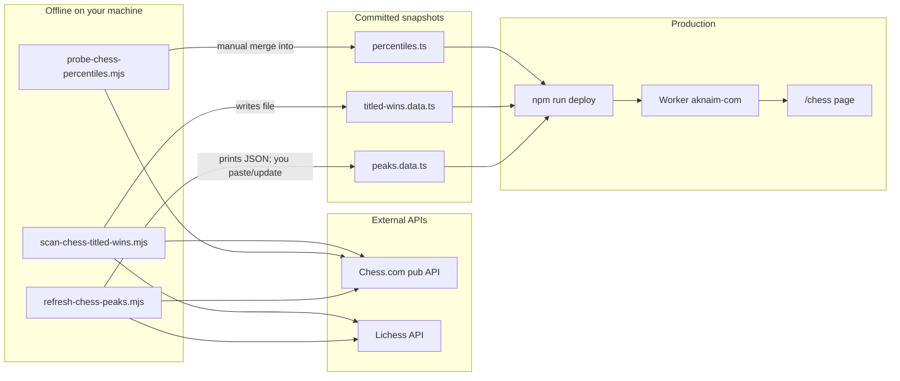
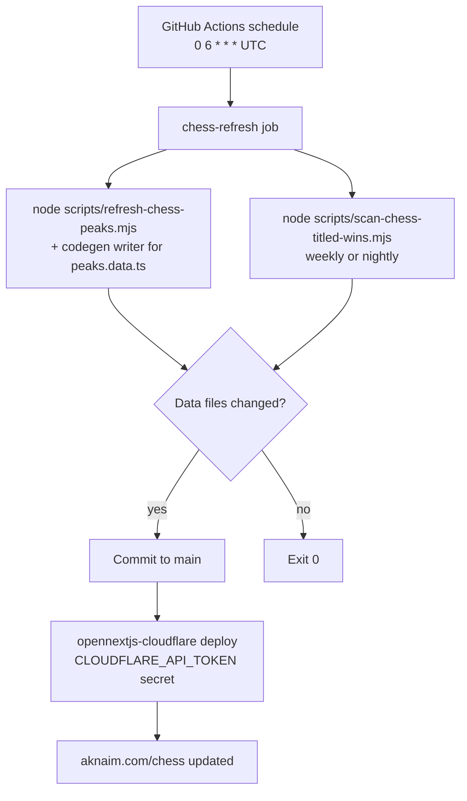

# Chess stats today + nightly production refresh

**Status: parked plan** (do not implement yet).

Today chess peaks and titled wins are generated offline into committed TypeScript data files and baked into the Worker at deploy—no live Chess.com/Lichess calls on Cloudflare. A nightly job would re-run those scripts, commit updates, and deploy so production stays fresh.

## Todos

- [ ] Teach `refresh-chess-peaks.mjs` to write `peaks.data.ts` (typed shape, preserve game URLs where available)
- [ ] Add GitHub Actions cron: nightly peaks, weekly titled-wins scan, commit if changed
- [ ] Wire Actions deploy with Cloudflare token secrets after successful data commit
- [ ] Document chess refresh cadence and secrets in development-and-deployment / maintainer-snapshot

## How it works today

Chess stats are **not** loaded from Neon or fetched at request time. The Worker intentionally uses sticky snapshots so SSR never hits Chess.com/Lichess ([`src/lib/chess/fetch.ts`](../../src/lib/chess/fetch.ts): *"Sticky peaks only — no live network on the Worker"*).

| Script | Job | Output |
|--------|-----|--------|
| [`scripts/refresh-chess-peaks.mjs`](../../scripts/refresh-chess-peaks.mjs) | Peak bullet/blitz/rapid from Chess.com (`aknaim`, `ablindchessplayer`) + Lichess (`Aknaim`) | JSON to stdout — **does not write** [`peaks.data.ts`](../../src/lib/chess/peaks.data.ts) |
| [`scripts/scan-chess-titled-wins.mjs`](../../scripts/scan-chess-titled-wins.mjs) | Full archive scan for wins vs titled players; rate-limited sleeps | **Writes** [`titled-wins.data.ts`](../../src/lib/chess/titled-wins.data.ts) |
| [`scripts/probe-chess-percentiles.mjs`](../../scripts/probe-chess-percentiles.mjs) | Chess.com overview percentiles (fragile web/service call) | Manual merge into [`percentiles.ts`](../../src/lib/chess/percentiles.ts) |

Runtime path: [`getChessAccountPeaks()`](../../src/lib/chess/fetch.ts) / `TITLED_WINS` → [`src/app/chess/page.tsx`](../../src/app/chess/page.tsx).

## Proposed nightly architecture (recommended)

Keep the static-file model (fits Worker limits and your current “no auto-deploy for every push” preference can still apply). Add a **GitHub Actions cron** that owns the refresh + ship loop:

**Concrete choices for this plan:**

1. **Extend peaks script** to write [`peaks.data.ts`](../../src/lib/chess/peaks.data.ts) (and merge Chess.com percentiles when the probe is reliable), instead of stdout-only paste.
2. **Nightly:** peaks (+ percentiles if stable). **Weekly:** full titled-wins scan (slow; months of archives + titled-player list).
3. **Ship path:** Actions commits on `main` when files change, then runs the same OpenNext/Wrangler deploy you use locally, using repo secrets (`CLOUDFLARE_API_TOKEN`, account id). No Neon involved.
4. **Not chosen:** moving chess into Neon + Neon Function cron — larger rewrite for little gain while pages read static modules.

## Gaps to close before it is hands-off

- Peaks refresh is print-only today; needs a writer that preserves typed `CHESS_ACCOUNT_PEAKS` shape and game URLs where APIs provide them.
- Chess.com percentiles are a separate, brittle probe — nightly can keep last-known percentiles if the probe fails.
- Titled-wins job needs generous timeout + polite rate limits (already has `sleep` in the script).
- Deploy secrets must live in GitHub Actions (you previously deferred general auto-deploy; this would be a **chess-only** or **data-refresh** deploy path).

## Out of scope for the first cut

- Live per-request API fetches on the Worker
- Neon tables for chess stats
- Changing the `/chess` UI
