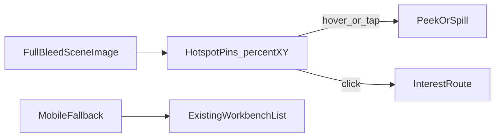

# Interactive workshop homepage — feasibility and approach

**Status: parked plan** (do not implement yet).

Yes — feasible by reusing the travel map pin system and the existing bag/peek asset pattern. Hotspots open interests; bag hover can spill peek items via CSS + cutouts (not physics). Keep the shelf UI as the mobile/list fallback.

## Todos

- [ ] Commission/compose one workshop full-bleed background that matches current brand
- [ ] Add sceneX/sceneY (and optional object id) to interest shell/data
- [ ] Build cover-aware hotspot layer reused from travel pin math; hover label + link to interest
- [ ] On bag hover, open bag + CSS-stagger spill cutouts (reuse peek assets); reduced-motion = instant open
- [ ] Adapt travel pin-pick flow for placing homepage objects
- [ ] Keep ActiveWorkbench/Cupboard as mobile (and optional List view) until scene hit-targets are proven

## Verdict

**Feasible.** Not a rewrite of the data model — mostly a new homepage presentation layer. Reusing travel pins is right.

The current homepage is shelf/list UX ([`ActiveWorkbench`](../../src/components/sections/ActiveWorkbench.tsx) + [`StorageCupboard`](../../src/components/sections/StorageCupboard.tsx)). There is an unused scene sketch ([`WorkshopScene`](../../src/components/sections/WorkshopScene.tsx)) that never shipped. Travel already solved **% placement on an `object-cover` image** plus admin pin-pick — that is the placement engine to reuse, not invent.

Prefer a **workshop / toolshed** scene that matches the existing dark craft aesthetic over a generic “lofi girl” room. Same interaction idea (explore objects), different art direction.

## How interaction would work

- Each interest (or object) has `{ x, y }` in **image percent**, same idea as travel `mapCoordinates`.
- Placement math must use travel’s cover-aware positioning ([`TravelPageClient`](../../src/components/sections/travel/TravelPageClient.tsx) / `mapPinPosition`) so pins stay on the photo when the viewport crops.
- Admin placement can copy travel’s `?pinPick=1` + localStorage loop.

## Bag hover: contents “fall out”

**Yes — that’s a great hover beat**, and it matches what you already do with closed bag → peek.

Recommended way (not a physics engine):

1. **Idle:** closed bag art on the scene at the pin.
2. **Hover/focus:** swap to open bag (existing `peekImage` or a scene-specific open still) **and** layer 2–4 small “spill” sprites (chalk, camera, shoe, etc.) that CSS-animate downward / outward with stagger (`translateY` + opacity, ~200–400ms).
3. **Click:** navigate to the interest (same as today).

You need **extra cutout assets** for a convincing spill (transparent PNGs/WebPs of a few iconic items), not a full frame sequence. True rigid-body physics is unnecessary and heavy; staged CSS motion reads as “stuff fell out” and stays controllable for layout/a11y (`prefers-reduced-motion` → instant open, no spill).

Same pattern generalizes: chisel “lifts,” guitar strings “shimmer,” cupboard doors open — each hotspot type can have a small motion recipe.

## Animation / assets — what you actually need

You do **not** need a full animation pipeline for v1.

| Approach | Assets per object | Feel |
|----------|-------------------|------|
| **V1** | Idle prop + glow/scale; click → interest | Light, shippable |
| **V1.5 (bags)** | Closed + open + 2–4 spill cutouts with CSS fall | “Contents fall out” on hover |
| **V1.5 (tools)** | Idle + activated still (chisel lifted, cupboard ajar) | Clear feedback |
| **Later** | Sprite / Lottie for strum, dust, etc. | Higher art cost |

So: **multiple assets help for the spill**, but they’re a handful of stills + CSS — not frame-by-frame video. Guitar “strum” can stay CSS + optional sound later.

## Hard parts (be honest)

1. **Art direction** — one coherent hero illustration (or photo collage) where chisel / guitar / bag / cupboard read clearly at phone and desktop sizes. This is the real cost, not the pin code.
2. **Mobile** — travel currently hides map pins on small screens. A room homepage needs either large hit targets + pan/zoom, or **keep today’s workbench list as the mobile path** and ship the scene for `md+` first.
3. **Discoverability** — explorers miss objects; need a short cue (“Explore the bench”) and maybe a “List view” toggle.
4. **Scope creep** — avoid building a game engine (inventory, NPCs, day/night). Hotspots → interests is enough.

## Recommended scope (concrete)

1. One full-bleed **workshop scene** background (commissioned or composed to match current brand).
2. Data: per-interest `sceneX` / `sceneY` (and optional `sceneObject` id for which prop art to use).
3. Hotspot layer: reuse travel pin math; click → `getInterestHref`; hover → label + bag spill (open + staggered cutouts) or tool lift for non-bags.
4. Admin: pin-pick page or admin tool modeled on travel pin pick.
5. **Desktop/tablet first**; mobile keeps current ActiveWorkbench + Cupboard (tap can show open/spill briefly, then link).
6. Do not delete the shelf components until the scene proves out.

## What not to do first

- Full lofi live wallpaper / ambient music loop as a requirement.
- Per-object multi-frame animations.
- Replacing all interest pages with in-scene modals.
- Building on unfinished `WorkshopScene` CSS as-is — treat it as inspiration only.

## Feasibility bottom line

| Piece | Status |
|-------|--------|
| Pin % placement + admin pick | Already built for travel |
| Interest routing + peek assets | Already built |
| Scene shell | Concept exists; needs a real background |
| Object open/close | Same pattern as bag/peek (2 images) |
| Mobile exploration | Hardest UX — ship list fallback first |

**Effort shape:** medium product/design (art + placement), low–medium engineering if you reuse travel pins and keep shelf as fallback. High if you insist on mobile parity + rich per-object animation on day one.
